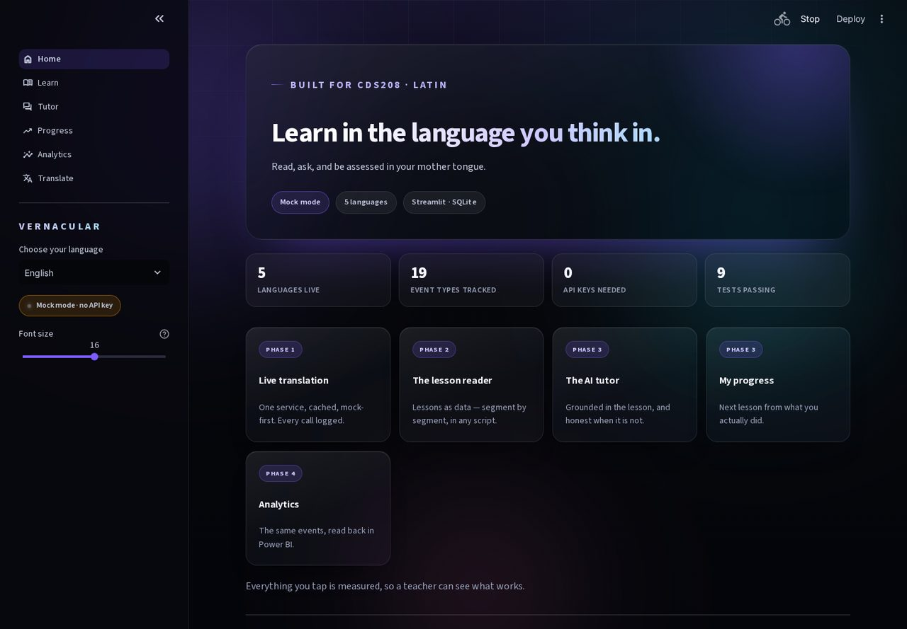
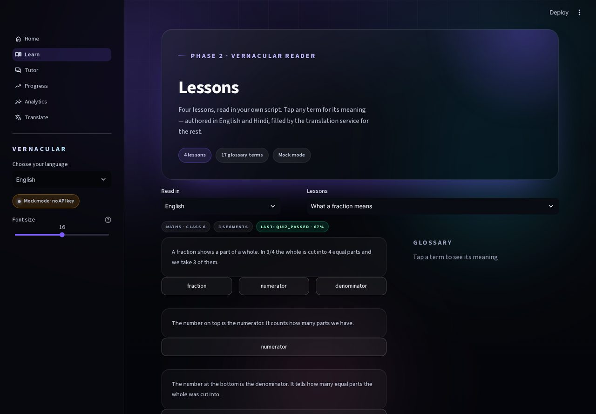
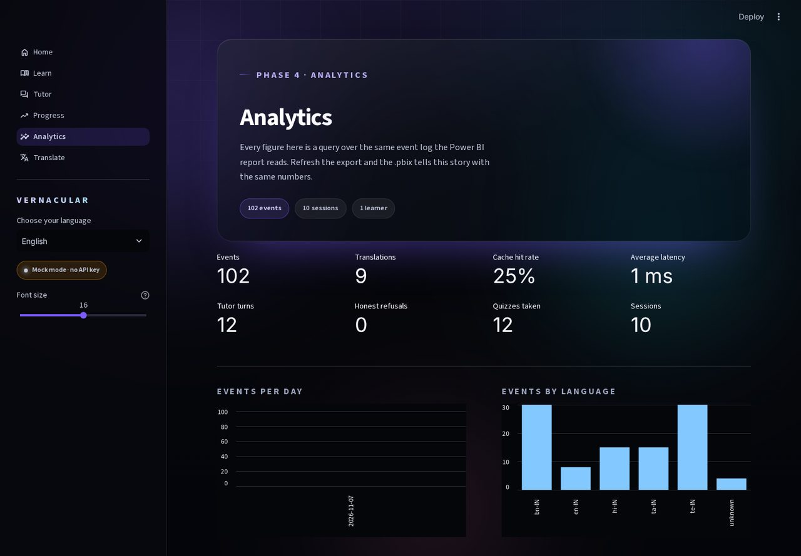

# Vernacular Education & Real-Time Translation Platform

A learning platform where a student reads a lesson in their mother tongue, taps any
term for an instant gloss, asks an AI tutor that answers in that language without
inventing facts, and is assessed on it — while every one of those actions becomes a
row in an event log a teacher can read in Power BI.

**CDS208 final project.** Python 3.11+ · Streamlit · SQLite → Postgres · Sarvam AI ·
Power BI Desktop. Runs with **no API key and no internet** — every AI path has a
labelled mock, so the demo cannot be broken by Wi-Fi.




## The problem, in one number

40% of people globally are not taught in a language they speak and understand
fluently, rising to 90% in some low- and middle-income countries. In India the gap
shows up in outcomes: in ASER 2024, 76.6% of Class 3 students in government schools
could not read a Class 2 level text — in a survey that itself had to run in 22
languages to reach the children it was measuring. The device is no longer the
barrier: 84% of rural households have a smartphone. The language layer is.

## What it does

Five surfaces, one loop, one event log behind all of them.

| Surface | What happens |
|---|---|
| **Home** | The whole interface in the learner's language, with the runtime state shown honestly (Mock / live, database, languages) |
| **Learn** | Lesson segments rendered in the learner's script; every key term is a button that glosses it in place, labelled *authored* or *translated* |
| **Translate** | Two-panel workspace: provider badge, latency in ms, cache hits, character counter, recent-translations table |
| **Tutor** | Grounded in the selected segment. Answers in the learner's language, and **refuses** when the lesson does not cover the question |
| **Progress** | Rule-first recommendation with its reason written in the learner's language, plus a per-lesson table |
| **Analytics** | Live metrics from the event log, and one button that writes the Power BI export |




## Architecture

```
┌──────────────────────────────────────────────────────────────────┐
│ 1. PRESENTATION   Streamlit pages + custom HTML/CSS/JS           │
│    Home · Learn · Translate · Tutor · Progress · Analytics       │
└───────────────────────────┬──────────────────────────────────────┘
                            │ plain Python calls, no HTTP hop
┌───────────────────────────▼──────────────────────────────────────┐
│ 2. SERVICES       lessons.py · translate.py · quiz.py · export.py│
│    plain arguments in, plain dicts out — no Streamlit imports    │
└───────────────────────────┬──────────────────────────────────────┘
                            │
┌───────────────────────────▼──────────────────────────────────────┐
│ 3. AGENTS + AI    agents/tutor.py · agents/coach.py              │
│    core/llm.py → sarvam | mock  (one file to change provider)    │
└───────────────────────────┬──────────────────────────────────────┘
                            │
┌───────────────────────────▼──────────────────────────────────────┐
│ 4. DATA           core/db.py (SQLite dev → Postgres prod)        │
│    events = append-only source of truth for all analytics        │
└───────────────────────────┬──────────────────────────────────────┘
                            │ on demand
┌───────────────────────────▼──────────────────────────────────────┐
│ 5. ANALYTICS      exports/*.csv + _health.json → Power BI .pbix  │
└──────────────────────────────────────────────────────────────────┘
```

Two rules hold it together: **services never import Streamlit** (so they are
testable and reusable), and **pages never call the AI provider directly** (always
through a service). That is what makes the front end replaceable without touching
the logic.

## Quick start

```bash
git clone https://github.com/bhavyanpotla/cds208-vernacular-edu.git
cd cds208-vernacular-edu
python -m venv .venv && source .venv/bin/activate     # Windows: .venv\Scripts\activate
pip install -r requirements.txt
streamlit run app.py
```

No `.env` needed. With no `SARVAM_API_KEY` the sidebar shows a **Mock mode** badge
and every AI path returns a visibly labelled mock result — nothing silently
pretends to be real.

To use the real provider:

```bash
cp .env.example .env    # then put your key in SARVAM_API_KEY
```

What changes with a key: translations come from Sarvam `mayura:v1` instead of a
labelled mock, and the tutor answers via `sarvam-m` instead of the offline
lesson-derived reply. Nothing else in the app changes — not one line of page code.

Want a dashboard with data in it immediately?

```bash
python scripts/seed_demo.py --reset    # ~90 events across four languages
```

## Languages

English, हिन्दी, বাংলা, தமிழ், తెలుగు — five done properly rather than eleven done
badly. Adding a sixth is one entry in `core/config.py` plus its strings in
`core/i18n.py`; the UI, lessons, glossary, tutor and dashboard pick it up.

Only English and Hindi lesson content is hand-authored. Tamil, Telugu and Bengali
are a **content gap that the translation service closes on first read** and caches in
SQLite — which is the product's thesis expressed in code, and why the gloss card
tells you whether a definition was authored or translated.

## Analytics

Every user action appends to `events`. The Analytics page queries that table
directly; **Refresh export** writes the same data into `exports/` as four CSVs plus
`_health.json`, and Power BI Desktop reads that folder. The full build sequence —
relationships, fourteen DAX measures, three report pages — is in
[`docs/powerbi.md`](docs/powerbi.md).

`_health.json` is the guard: row counts, null rates, cache hit rate, and the list of
documented events that have **never fired**. If a feature is missing from the
dashboard, that audit names it before an examiner does.

Two measures worth naming: **Cache Hit %** is the cost story, and **Refusal Rate**
(the share of tutor questions answered with an honest "not in this lesson") is the
safety story. Most projects have neither.

## Deploy

[`docs/deploy.md`](docs/deploy.md) has the full Streamlit Community Cloud walkthrough.
The short version: push to GitHub → share.streamlit.io → new app → `app.py` → secrets
in the dashboard, never in the repo. Note that Community Cloud has an ephemeral
filesystem, so the SQLite file is recreated empty on restart; run
`python scripts/seed_demo.py` or click through the app once after a deploy.

## Tests

```bash
pip install -r requirements.txt ruff pytest
ruff check .
python -m pytest
```

78 tests, all passing, no network and no API key required. They cover the mock
contract (a provider failure degrades instead of raising), the cache layers, lesson
localisation, quiz scoring, the tutor's refusal rule, the recommender's fallbacks,
and the export pipeline — plus headless boots of the real app that click buttons and
assert what lands on screen.

CI runs lint, tests and an import smoke test on every push.

## Tech stack → themes

Adjust the unit names to your own syllabus wording; the mapping is what matters.

| Component | File(s) | Theme it demonstrates |
|---|---|---|
| Provider adapter with mock fallback | `core/llm.py` | AI integration, graceful degradation, API design |
| Cached translation service | `core/translate.py` | Service layer, caching strategy, latency measurement |
| Grounded tutor + refusal | `agents/tutor.py`, `agents/prompts.py` | Prompt engineering, hallucination control, evaluation |
| Rule-first recommender | `agents/coach.py` | Hybrid ML/rule systems, deterministic fallbacks |
| Event schema + append-only log | `core/events.py`, `core/db.py` | Data modelling, analytics engineering |
| CSV export + health checks | `core/export.py` | ETL, data quality, BI handoff |
| Power BI model + DAX | `docs/powerbi.md` | Visual analytics, DAX, dashboard design |
| Streamlit + custom CSS/JS | `pages/`, `assets/` | Front-end engineering, accessibility, responsive design |
| 78 tests + CI | `tests/`, `.github/` | Software engineering practice |

## Structure

```
app.py                 entry: page config, CSS, session bootstrap, navigation
pages/1_Home.py        Home surface
pages/2_Translate.py   two-panel translation workspace
pages/3_Learn.py       reader, tap-to-translate glosses, static quiz
pages/4_Tutor.py       grounded chat tutor with context picker
pages/5_Progress.py    recommendation, per-lesson table, event breakdown
pages/6_Analytics.py   live metrics, DAU, language mix, struggle list, export
core/config.py         the only module that reads the environment
core/db.py             SQLite schema + connection (Postgres swap lives here)
core/events.py         log_event() — append-only analytics source of truth
core/llm.py            provider adapter: sarvam | mock, retries, 1000-char chunking
core/translate.py      translation service: memory cache → SQLite → provider → event
core/lessons.py        load/localise lessons + glossary, filling missing languages
core/quiz.py           pure scoring + progress/event recording
core/export.py         four CSVs + _health.json for Power BI, plus chart queries
core/i18n.py           UI strings for five languages
core/ui.py             HTML builders: hero, cards, chips, glass panels
agents/prompts.py      every system prompt, one place
agents/tutor.py        grounded answers + honest refusal, offline and live
agents/coach.py        rule-first recommender; the model only phrases the reason
agents/phrases.py      offline phrasing in all five languages
content/lessons/*.json four lessons, English + Hindi authored inline
content/glossary.json  term → per-language explanation
assets/styles.css      one stylesheet: dark glass, 3D tilt, AA contrast, responsive
assets/app.js          optional pointer-tilt + parallax enhancer
scripts/seed_demo.py   fills a fresh deployment with plausible activity
docs/powerbi.md        .pbix build: model, DAX, three pages
docs/deploy.md         Streamlit Community Cloud walkthrough
```

## Limitations

- **Four lessons, not a curriculum.** This demonstrates the loop; it is not a content library.
- **Speech (STT/TTS) is not built.** It is on the roadmap, behind a feature flag. The text path is the product.
- **Tutor grounding is lexical, not semantic.** A question phrased with none of the lesson's vocabulary is treated as outside it. It errs toward refusing, which is the right direction for a tutor.
- **Mock mode is not a model.** It is deterministic and visibly labelled; the numbers on the dashboard are real, the translated text is not.
- **Single local learner profile.** No auth until a later phase; the `users` table is ready for it.
- **SQLite on Community Cloud is ephemeral.** Data resets on restart; a Postgres/Supabase swap is confined to `core/db.py`.
- **Power BI refresh is manual.** No scheduled gateway refresh; the export button is the trigger.

## License

Academic project — CDS208 coursework.
